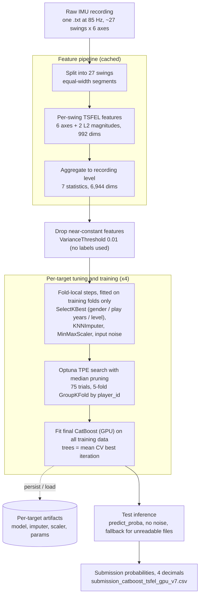

# AI CUP 2025 Spring — Smart Racket Table Tennis Classification

[](https://tbrain.trendmicro.com.tw/Competitions/Details/39)
[](requirements.txt)
[](#competition-result)

Solution for the AI CUP 2025 Spring smart-racket challenge. The task is to predict four table-tennis
player attributes from six-axis IMU swing recordings:

- `gender`
- `hold racket handed`
- `play years`
- `level`

The whole pipeline lives in a single, self-contained notebook
([aicup_submission.ipynb](aicup_submission.ipynb)): feature extraction, per-target hyperparameter tuning,
training, and test-set prediction.

## Competition result

**Private Leaderboard ROC AUC 0.806**, the arithmetic mean of the four per-target AUCs, matching the
competition's scoring.

The leaderboard score was obtained with an earlier version of this notebook (commit `8170835`).

## How it works



Intermediate TSFEL features and the four per-target artifacts are cached to disk. With
`USE_SAVED_MODELS = True` the notebook loads existing artifacts and skips training, so a re-run only
regenerates the test predictions.

## Dataset

Each recording (`unique_id`) is a raw `.txt` file holding one test session by one player, sampled at
**85 Hz**, with six-axis IMU time series:

- Accelerometer: `Ax`, `Ay`, `Az`
- Gyroscope: `Gx`, `Gy`, `Gz`

A session normally contains 27 swings, and the file may also include disturbance before and after the
test. `cut_point` gives the organizer's swing boundaries, which may contain slight errors. Datasets are
**not** committed.

The organizer defines ten swing modes:

| `mode` | Test | Task |
| --- | --- | --- |
| 1, 2 | Power | Forehand stroke / forehand loop, air swings (27) |
| 3–8 | Power | Precise forehand hits from a serving machine at 50 balls/min (27): forehand-side diagonal / straight, side-body diagonal / straight, two-point footwork diagonal / straight |
| 9, 10 | Aerobic | Increasing ball frequency until exhaustion; files may hold fewer than 27 swings |

Modes 9 and 10 make up 1,614 of the 1,955 training recordings. Class meanings: `play years` 0 / 1 / 2 =
low / medium / high (binned from all players' playing years); `level` 2 = college Division A, 3 = college
Division B, 4 = youth national team, 5 = youth players.

```text
39_Training_Dataset/
  train_info.csv
  train_data/{unique_id}.txt

39_Test_Dataset/
  test_info.csv
  sample_submission.csv
  test_data/{unique_id}.txt
```

Training metadata columns:

```text
unique_id, player_id, mode, gender, hold racket handed, play years, level, cut_point
```

`player_id` is the grouping key used for leakage-safe cross-validation. This notebook segments each
recording into 27 equal-width windows with `np.linspace`; it does **not** use the `mode` covariate or the
`cut_point` swing boundaries, so segments do not line up exactly with swings, especially when a file
includes pre- or post-test disturbance or fewer than 27 swings.

| Dataset | Recordings | Players |
| --- | ---: | ---: |
| Training | 1,955 | 42 |
| Test | 1,430 | — |

## Evaluation protocol

- Single 5-fold `GroupKFold`, grouped by `player_id`, so a player never appears in both train and
  validation within a fold.
- Every label-dependent step (`SelectKBest`) and every fitted transform (`KNNImputer`, `MinMaxScaler`) is
  fitted on the training folds only.
- Per-target hyperparameter search with Optuna TPE: 75 trials each (300 total across four targets). The
  running mean AUC is reported after each fold so `MedianPruner` can stop weak trials; each study is
  capped at a 2.5-hour wall-clock timeout.
- Competition AUC per target: ROC AUC for the binary targets, micro-OvR ROC AUC for the multiclass
  targets.
- Mean AUC across the four targets as the headline metric.

The best Optuna trial value is still selected on the same folds it is reported on, and the validation
fold drives early stopping, so it remains somewhat optimistic. It is a single split over only 42 players
with no nested loop or uncertainty estimate; an unbiased estimate needs the chosen parameters
re-evaluated on a fresh fold split.

## Model overview

A single modeling approach, trained independently for each of the four targets.

**Features.** Each recording is split into 27 swing segments. For every segment, TSFEL extracts temporal,
spectral, and statistical features at 85 Hz from the 6 raw axes plus 2 L2 magnitudes (acceleration and
gyroscope), giving 992 per-segment dimensions (124 per signal). The 27 segments are aggregated with 7
statistics (`mean / std / median / min / max / skew / kurtosis`) into a 6,944-dim recording-level vector.
TSFEL extraction runs in parallel across CPU cores.

**Selection.** `VarianceThreshold(0.01)` removes near-constant columns. For `gender`, `play years`, and
`level`, an additional `SelectKBest(f_classif)` is fitted inside each fold, with `k` tuned by Optuna
(lower bound 20, upper bound the number of available features); each target keeps its own feature subset.
`hold racket handed` uses every feature that passes the variance threshold.

**Learner.** A per-target `CatBoostClassifier` (`task_type='GPU'`) with fold-local `KNNImputer(5)` and
`MinMaxScaler`, optional Gaussian input noise on the training data (seeded), and early stopping on the
validation fold during CV. The final model is trained on all training data with the number of trees set to
the mean best iteration across the CV folds. Class imbalance is handled with `scale_pos_weight` for
`gender` and optional balanced class weights for `play years` / `level` (toggled by Optuna).

## Engineering highlights

- Per-target Optuna TPE tuning (75 trials each) with median pruning and a 2.5-hour timeout per study.
- Player-grouped 5-fold `GroupKFold` to avoid player leakage in cross-validation.
- Fold-local `SelectKBest`, `KNNImputer` and `MinMaxScaler`, and seeded input-noise regularization on the
  training folds only.
- Per-target feature selection (`VarianceThreshold` + Optuna-tuned `SelectKBest`).
- Class-imbalance handling: `scale_pos_weight` (`gender`) and optional balanced class weights
  (`play years` / `level`).
- Cached TSFEL features (extracted in parallel) and persisted per-target artifacts
  (model / imputer / scaler / params), with `USE_SAVED_MODELS` for fast re-runs.
- Robust feature extraction for very short recordings, and inference fallbacks (binary `0.5`, multiclass
  `1 / n_classes`) for test recordings whose feature file is missing, empty or unreadable.
- GPU training via CatBoost `task_type='GPU'`.

## Project structure

```text
.
aicup_submission.ipynb                      # the entire pipeline (one notebook)
requirements.txt                            # pinned environment (Python 3.12)
README.md
.gitignore

# generated at runtime, gitignored (not committed):
39_Training_Dataset/                        # official training data
39_Test_Dataset/                            # official test data
tabular_data_train_tsfel_catboost_gpu_v7/   # cached TSFEL segment features (train)
tabular_data_test_tsfel_catboost_gpu_v7/    # cached TSFEL segment features (test)
trained_models_catboost_v7/                 # per-target artifacts (.cbm / .joblib / .json)
submission_catboost_tsfel_gpu_v7.csv        # final submission
```

## Setup

```bash
pip install -r requirements.txt jupyterlab
```

Requirements:

- Python 3.12. `tsfel==0.1.9` does not run on Python 3.13 or newer.
- `PyWavelets==1.8.0`. Newer releases change TSFEL's Wavelet feature values.
- An NVIDIA GPU + CUDA (CatBoost `task_type='GPU'`).

## Running

1. Place `39_Training_Dataset/` and `39_Test_Dataset/` at the repository root.
2. Run all cells of [aicup_submission.ipynb](aicup_submission.ipynb).

Intermediate features and model artifacts are cached, so subsequent runs skip the expensive steps. To
**retrain from scratch**, set `USE_SAVED_MODELS = False` near the top of the notebook, or delete
`trained_models_catboost_v7/` and the two `tabular_data_*_v7/` cache folders.

Main tunable constants:

| Constant | Default | Meaning |
| --- | --- | --- |
| `NUM_TOTAL_SEGMENTS_PER_FILE` | 27 | Swing segments per recording |
| `N_SPLITS_GROUPKFOLD` | 5 | GroupKFold folds |
| `OPTUNA_N_TRIALS` | 75 | Optuna trials per target |
| `TSFEL_SAMPLING_FREQ` | 85 | Sensor sampling rate (Hz) used by TSFEL |
| `N_JOBS_TSFEL` | -1 | Parallel processes for TSFEL extraction (-1 = all cores) |
| `USE_SAVED_MODELS` | `True` | Load saved artifacts and skip training |

## Honest interpretation

What carried the result was not a single clever trick but a few solid choices:

1. Player-grouped cross-validation, so no player appears on both sides of a split.
2. Fold-local selection, imputation and scaling fitted only on training folds.
3. A rich TSFEL representation aggregated to the recording level.
4. Per-target feature selection and per-target Optuna tuning rather than one shared configuration.

Known limitations:

- The reported CV is the best Optuna trial value, so model selection and evaluation share folds; it is
  optimistic rather than fully held-out.
- A single split over only 42 players, with no nested loop and no uncertainty estimate.
- Equal-width segmentation ignores the provided `cut_point` swing boundaries and the `mode` covariate.
- Everything lives in one notebook, which makes testing and reproduction harder.

## Data & license

The AI CUP competition datasets are **not** included or redistributed here and remain subject to their
original competition terms. No separate code-license file is provided in this repository.

## References

- CatBoost: <https://catboost.ai>
- TSFEL: <https://tsfel.readthedocs.io>
- Optuna: <https://optuna.org>
- scikit-learn: <https://scikit-learn.org>

## AI Assistance Disclosure

AI tools were used to assist with English translation, language polishing, and formatting. The
model design and core technical decisions were developed, evaluated, and validated by the author. All
AI-assisted content was reviewed and revised before publication.
