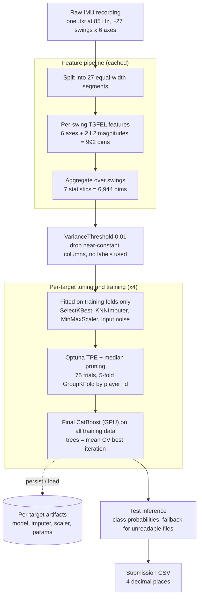

# AI CUP 2025 Spring — Smart Racket Table Tennis Classification

[](https://tbrain.trendmicro.com.tw/Competitions/Details/39)
[](requirements.txt)
[](https://catboost.ai)
[](https://optuna.org)

Predicting a table-tennis player's **gender**, **racket hand**, **years of play** and **competitive level**
from the six-axis motion sensor in a smart racket. The whole pipeline — feature extraction, per-target
tuning, training and test-set prediction — lives in one self-contained notebook,
[`aicup_submission.ipynb`](aicup_submission.ipynb).

## Contents

- [Overview](#overview)
- [Quick start](#quick-start)
- [How it works](#how-it-works)
- [Dataset](#dataset)
- [Model overview](#model-overview)
- [Evaluation protocol](#evaluation-protocol)
- [Engineering notes](#engineering-notes)
- [Configuration](#configuration)
- [Project structure](#project-structure)
- [Limitations and future work](#limitations-and-future-work)
- [Data & license](#data--license)
- [References](#references)

## Overview

| Aspect | Summary |
| --- | --- |
| **Input** | One recording per test session: about 27 swings of `Ax Ay Az Gx Gy Gz` at 85 Hz |
| **Targets** | `gender`, `hold racket handed` (binary) · `play years` (3 classes), `level` (4 classes) |
| **Features** | TSFEL temporal / spectral / statistical features per swing, aggregated to 6,944 per recording |
| **Model** | One `CatBoostClassifier` per target on GPU, tuned with Optuna (75 trials each) |
| **Validation** | 5-fold `GroupKFold` by `player_id`; every fitted step stays inside the training fold |
| **Metric** | ROC AUC (binary) and micro one-vs-rest ROC AUC (multiclass), averaged over the four targets |

## Quick start

### Setup

```bash
pip install -r requirements.txt jupyterlab
```

| Requirement | Why |
| --- | --- |
| Python 3.12 | `tsfel==0.1.9` does not run on Python 3.13 or newer |
| `PyWavelets==1.8.0` | Newer releases change TSFEL's Wavelet feature values |
| NVIDIA GPU + CUDA | CatBoost is trained with `task_type='GPU'` |

### Running

1. Place `39_Training_Dataset/` and `39_Test_Dataset/` at the repository root (see [Dataset](#dataset)).
2. Run all cells of [`aicup_submission.ipynb`](aicup_submission.ipynb).
3. The submission is written to `submission_catboost_tsfel_gpu_v7.csv`.

TSFEL features and per-target model artifacts are cached to disk. With `USE_SAVED_MODELS = True`, a re-run
loads the saved models and only regenerates the test predictions. To **retrain from scratch**, set
`USE_SAVED_MODELS = False`, or delete `trained_models_catboost_v7/` and the two `tabular_data_*_v7/` folders.

## How it works



## Dataset

The AI CUP datasets are **not** included in this repository. Expected layout:

```text
39_Training_Dataset/
  train_info.csv          # unique_id, player_id, mode, gender, hold racket handed, play years, level, cut_point
  train_data/{unique_id}.txt
39_Test_Dataset/
  test_info.csv           # unique_id, mode, cut_point
  sample_submission.csv
  test_data/{unique_id}.txt
```

| Split | Recordings | Players |
| --- | ---: | ---: |
| Training | 1,955 | 42 |
| Test | 1,430 | — |

**Recordings.** Each `{unique_id}.txt` holds one test session by one player: six columns
(`Ax Ay Az` acceleration, `Gx Gy Gz` angular velocity) sampled at **85 Hz**. A session normally contains 27
swings and may include movement before and after the test. `cut_point` gives the organizer's swing
boundaries, which may contain slight errors.

**Swing modes.**

| `mode` | Test | What the player does |
| --- | --- | --- |
| 1–2 | Power | Forehand stroke or forehand loop, swinging in the air, 27 times |
| 3–8 | Power | Precise forehand hits from a serving machine at 50 balls/min (27): forehand-side diagonal / straight, side-body diagonal / straight, two-point footwork diagonal / straight |
| 9–10 | Aerobic | Ball frequency rises until exhaustion, so a file may hold fewer than 27 swings |

Modes 9 and 10 account for 1,614 of the 1,955 training recordings.

**Targets.**

| Target | Task | Classes |
| --- | --- | --- |
| `gender` | Binary | 1, 2 |
| `hold racket handed` | Binary | 1, 2 |
| `play years` | 3-class | 0 low · 1 medium · 2 high (binned from all players' playing years) |
| `level` | 4-class | 2 college Division A · 3 college Division B · 4 youth national team · 5 youth players |

Every attribute is constant for a given player, which is why `player_id` is the grouping key for
cross-validation.

## Model overview

The same pipeline is trained independently for each of the four targets.

**Features.** Each recording is split into 27 equal-width segments with `np.linspace`. For every segment,
TSFEL extracts temporal, spectral and statistical features at 85 Hz from the six raw axes plus two L2
magnitudes (total acceleration and total angular velocity): 124 features per signal, 992 per segment. The
27 segments are summarized with seven statistics (`mean`, `std`, `median`, `min`, `max`, `skew`,
`kurtosis`) into a 6,944-dimensional vector per recording.

**Selection.** `VarianceThreshold(0.01)` removes near-constant columns without looking at the labels. For
`gender`, `play years` and `level`, `SelectKBest(f_classif)` is then fitted inside each fold on the training
rows only, with `k` tuned by Optuna; each target keeps its own feature subset. `hold racket handed` uses
every feature that passes the variance threshold.

**Learner.** A `CatBoostClassifier` (`task_type='GPU'`) per target, preceded by fold-local
`KNNImputer(n_neighbors=5)` and `MinMaxScaler`. Optional Gaussian input noise (seeded) regularizes the
training rows. During CV the validation fold drives early stopping; the final model is trained on all
training data with the number of trees set to the mean best iteration across the folds.

**Hyperparameter search.** Optuna TPE, 75 trials per target:

| Parameter | Range |
| --- | --- |
| `iterations` | 500 – 2,500 (step 200) |
| `learning_rate` | 0.0005 – 0.05 (log) |
| `depth` | 3 – 6 |
| `l2_leaf_reg` | 0.1 – 10 (log) |
| `border_count` | 32 – 64 |
| `random_strength` | 1e-7 – 1 (log) |
| `bagging_temperature` | 0 – 1 |
| `early_stopping_rounds` | 40 – 100 (step 10) |
| `add_input_noise` / `noise_level` | off or on; 1e-4 – 0.02 (log) |
| `k` for `SelectKBest` | 20 – all features (`gender`, `play years`, `level`) |
| `scale_pos_weight` | 0.5× – 2× the negative / positive ratio (`gender`) |
| Balanced class weights | off or on (`play years`, `level`) |

## Evaluation protocol

- **Grouping.** 5-fold `GroupKFold` by `player_id`: a player never appears in both training and validation.
- **No leakage.** Every label-dependent step (`SelectKBest`) and every fitted transform (`KNNImputer`,
  `MinMaxScaler`) is fitted on the training folds only.
- **Search budget.** The running mean AUC is reported after each fold so `MedianPruner` can stop weak
  trials; each study is capped at 2.5 hours of wall-clock time.
- **Metric.** ROC AUC for the binary targets, micro one-vs-rest ROC AUC for the multiclass targets, and
  their mean across the four targets as the headline score.

The best Optuna trial is selected on the same folds it is scored on, and those folds also drive early
stopping, so the best-trial CV score is somewhat optimistic. An unbiased estimate requires re-evaluating
the chosen parameters on a fresh player split.

## Engineering notes

| Concern | Approach |
| --- | --- |
| Class imbalance | `scale_pos_weight` for `gender`; balanced class weights toggled by Optuna for `play years` and `level` |
| Short recordings | Aerobic tests can end early; if a TSFEL feature fails on a very short segment, only that feature is skipped, not the whole signal |
| Stable feature set | TSFEL's `Spectrogram mean coefficient` columns are named by length-dependent frequency bins, so the feature is disabled to keep one column set for every recording |
| Speed | TSFEL extraction runs in parallel across CPU cores; CatBoost trains on the GPU |
| Reproducibility | Cached features, persisted artifacts (model / imputer / scaler / params), seeded noise, pinned package versions |
| Robust inference | A test recording whose feature file is missing, empty or unreadable gets a neutral probability (`0.5` binary, `1 / n_classes` multiclass) |
| Submission format | Class probabilities written with at most four decimal places |

## Configuration

Main constants at the top of the notebook:

| Constant | Default | Meaning |
| --- | --- | --- |
| `NUM_TOTAL_SEGMENTS_PER_FILE` | 27 | Segments per recording |
| `N_SPLITS_GROUPKFOLD` | 5 | Cross-validation folds |
| `OPTUNA_N_TRIALS` | 75 | Optuna trials per target |
| `TSFEL_SAMPLING_FREQ` | 85 | Sensor sampling rate (Hz) |
| `N_JOBS_TSFEL` | -1 | Parallel processes for TSFEL extraction (-1 = all cores) |
| `RANDOM_SEED` | 42 | Seed for the input-noise generator |
| `USE_SAVED_MODELS` | `True` | Load saved artifacts and skip training |

## Project structure

```text
.
├── aicup_submission.ipynb    # the entire pipeline
├── requirements.txt          # pinned environment (Python 3.12)
├── README.md
└── .gitignore

Generated at runtime (gitignored):
├── 39_Training_Dataset/                       # official training data
├── 39_Test_Dataset/                           # official test data
├── tabular_data_train_tsfel_catboost_gpu_v7/  # cached per-swing TSFEL features (train)
├── tabular_data_test_tsfel_catboost_gpu_v7/   # cached per-swing TSFEL features (test)
├── trained_models_catboost_v7/                # per-target model, imputer, scaler, params
└── submission_catboost_tsfel_gpu_v7.csv       # submission file
```

## Limitations and future work

**Design choices that matter most**

1. Player-grouped cross-validation, so no player appears on both sides of a split.
2. Every label-dependent and fitted step kept inside the training fold.
3. A rich TSFEL representation aggregated to the recording level.
4. Per-target feature selection and tuning rather than one shared configuration.

**Limitations**

- The best-trial CV score is optimistic: model selection and evaluation share folds.
- One 5-fold split over only 42 players, with no nested loop and no uncertainty estimate.
- Equal-width segmentation ignores the `cut_point` swing boundaries, movement before and after a test, and
  the `mode` covariate.
- The whole pipeline lives in one notebook, which makes testing harder.

**Next steps**

- Segment swings with `cut_point` instead of equal-width windows.
- Condition on `mode`: air swings, machine-fed hits and aerobic tests differ.
- Nested, repeated player-grouped CV to separate tuning from evaluation and report uncertainty.
- Swing-level models whose predictions are pooled per recording.

## Data & license

The AI CUP competition datasets are **not** included or redistributed here and remain subject to their
original competition terms. No separate code-license file is provided in this repository.

## References

- CatBoost: <https://catboost.ai>
- TSFEL: <https://tsfel.readthedocs.io>
- Optuna: <https://optuna.org>
- scikit-learn: <https://scikit-learn.org>
- TTSWING, a related table-tennis swing dataset: <https://arxiv.org/abs/2306.17550>

## AI Assistance Disclosure

AI tools were used to assist with English translation, language polishing, and formatting. The
model design and core technical decisions were developed, evaluated, and validated by the author. All
AI-assisted content was reviewed and revised before publication.
