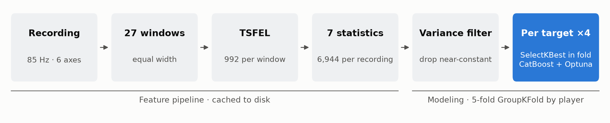
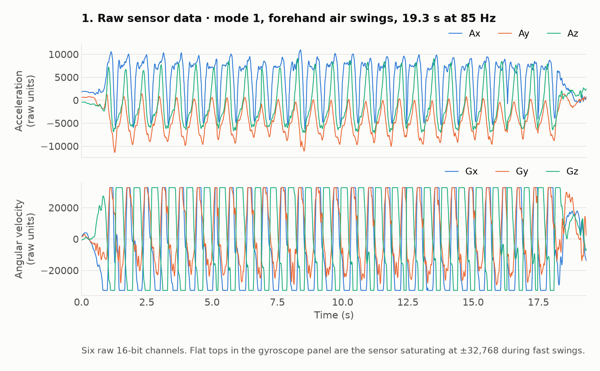
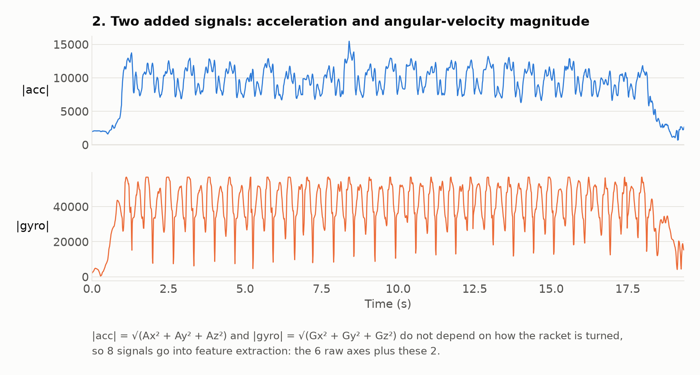
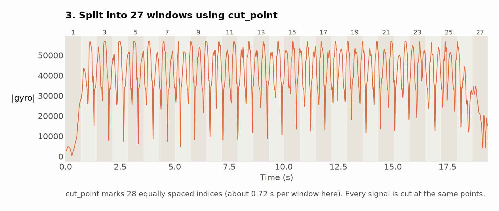
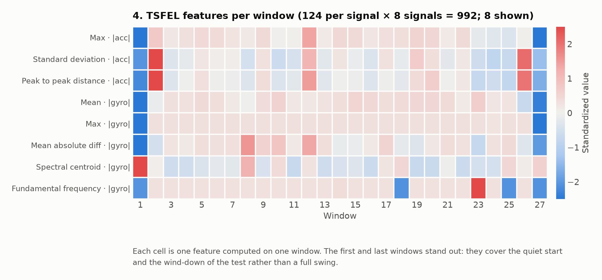
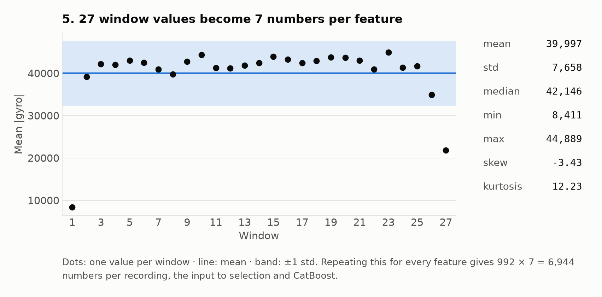
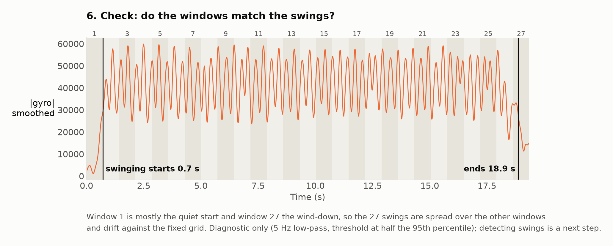
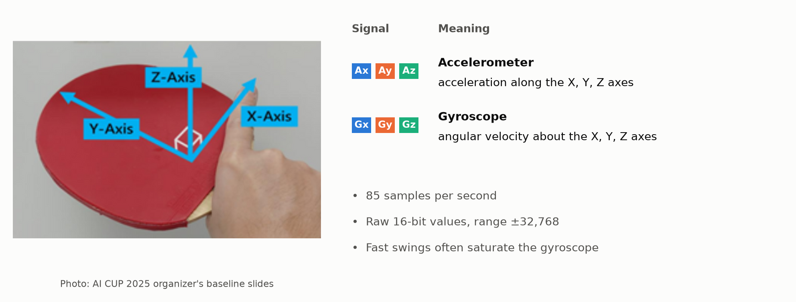
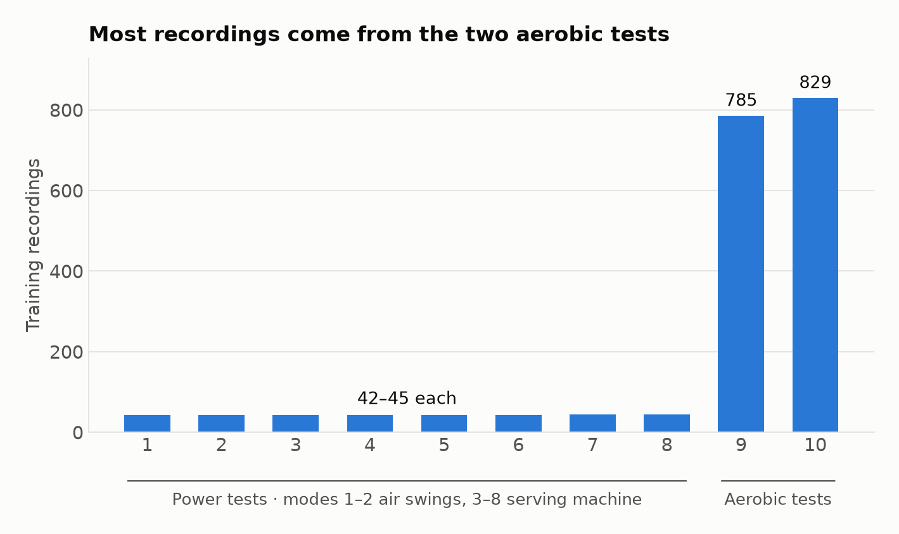

# AI CUP 2025 Spring — Smart Racket Table Tennis Classification

[](https://tbrain.trendmicro.com.tw/Competitions/Details/39)
[](requirements.txt)
[](https://catboost.ai)

Predicting a table-tennis player's gender, racket hand, years of play and competitive level from the
six-axis motion sensor inside a smart racket. The whole pipeline lives in one notebook,
[`aicup_submission.ipynb`](aicup_submission.ipynb).

**Highlights**

- **Player-grouped validation.** Every attribute is constant per player, so folds are split by player.
- **No leakage.** Feature selection, imputation and scaling are fitted on training folds only.
- **Rich features.** TSFEL temporal, spectral and statistical features, summarized over each test session.
- **Per-target tuning.** Four CatBoost models, each with its own features and Optuna-tuned settings.



## How it works

The figures below follow one training recording (a mode 1 session of forehand air swings) through the
feature pipeline. Features and trained models are cached, so re-runs skip the slow steps.

**1. Raw signals.** Six 16-bit channels at 85 Hz. During fast swings the gyroscope often saturates at
±32,768, which shows up as flat tops.



**2. Two added signals.** The acceleration and angular-velocity magnitudes do not depend on how the racket
is turned, so 8 signals go into feature extraction.



**3. Windows.** Each recording is cut into 27 windows at the `cut_point` indices, which in this data are
always 28 equally spaced points.



**4. Features per window.** TSFEL computes 124 temporal, spectral and statistical features for each of the
8 signals: 992 per window.



**5. Aggregation.** Each feature's 27 window values are summarized with 7 statistics, giving 6,944 features
per recording. Selection and the per-target CatBoost models work on this table.



**6. A check on the windows.** Swinging starts and stops a little inside the recording, so the first and
last windows hold little or no swing and the rest drift against real swings. This motivates detecting
swings directly (see [Limitations and next steps](#limitations-and-next-steps)).



## Quick start

### Setup

```bash
pip install -r requirements.txt jupyterlab
```

Requires **Python 3.12** (tsfel 0.1.9 does not run on 3.13+) and an **NVIDIA GPU with CUDA**.
`PyWavelets` is pinned to 1.8.0 because newer releases change TSFEL's wavelet features.

### Running

1. Put the competition data (not included) at the repository root:

   ```text
   39_Training_Dataset/   train_info.csv, train_data/{unique_id}.txt
   39_Test_Dataset/       test_info.csv, sample_submission.csv, test_data/{unique_id}.txt
   ```

2. Run all cells of the notebook. The submission is written to `submission_catboost_tsfel_gpu_v7.csv`.

To retrain from scratch, set `USE_SAVED_MODELS = False` or delete the `*_v7/` cache folders.

## Dataset

Each file is one test session by one player: acceleration and angular velocity on three axes, sampled at
85 Hz. A session normally holds 27 swings and may include movement before and after the test. The
organizer describes `cut_point` as approximate swing boundaries; in all 3,385 released files it equals 28
equally spaced indices over the whole recording.





| Mode | Test | What the player does |
| --- | --- | --- |
| 1–2 | Power | Forehand stroke or loop, swinging in the air, 27 times |
| 3–8 | Power | 27 precise forehand hits from a serving machine at 50 balls/min, from different positions and directions |
| 9–10 | Aerobic | Ball frequency rises until exhaustion, so a file may end before 27 swings |

The training set has 1,955 recordings from 42 players; modes 9–10 make up 1,614 of them. The test set has
1,430 recordings.

| Target | Classes |
| --- | --- |
| Gender | 1, 2 |
| Racket hand | 1, 2 |
| Play years | 0 low · 1 medium · 2 high |
| Level | 2 college Division A · 3 college Division B · 4 youth national team · 5 youth players |

## Model overview

**Features.** TSFEL runs at the sensor's 85 Hz on each window. Its spectrogram coefficients are disabled,
because their column names depend on window length and would leave most values empty. When a feature
fails on a very short window (an aerobic test stopped early), only that feature is skipped.

**Selection.** A variance threshold (0.01) removes near-constant columns without using labels. For gender,
play years and level, `SelectKBest` then keeps the top-k features, fitted on each fold's training rows
with k tuned by Optuna. Racket hand uses all remaining features.

**Model.** One `CatBoostClassifier` per target on GPU, after KNN imputation and min-max scaling. Optuna
tunes the tree settings, k, optional input noise and class weighting (75 trials per target). The final
model is refit on all training data, with the number of trees set to the average early-stopping point
from cross-validation.

<details>
<summary><b>Hyperparameter search space</b></summary>

| Parameter | Range |
| --- | --- |
| iterations | 500 – 2,500 (step 200) |
| learning_rate | 0.0005 – 0.05 (log) |
| depth | 3 – 6 |
| l2_leaf_reg | 0.1 – 10 (log) |
| border_count | 32 – 64 |
| random_strength | 1e-7 – 1 (log) |
| bagging_temperature | 0 – 1 |
| early_stopping_rounds | 40 – 100 (step 10) |
| input noise | off, or on with level 1e-4 – 0.02 (log) |
| k for SelectKBest | 20 – all features (gender, play years, level) |
| scale_pos_weight | 0.5× – 2× the class ratio (gender) |
| balanced class weights | off or on (play years, level) |

</details>

## Evaluation protocol

- **5-fold `GroupKFold` by player**, so no player appears in both training and validation.
- **Fold-local fitting** for every step that learns from data: selection, imputation and scaling.
- **Metric:** ROC AUC for gender and racket hand, micro one-vs-rest ROC AUC for play years and level,
  averaged over the four targets.
- **Search budget:** Optuna prunes weak trials after each fold; each target's search is capped at 2.5 hours.

The best Optuna trial is chosen on the same folds it is scored on, so its cross-validation score is
somewhat optimistic; confirming it needs a fresh player split.

<details>
<summary><b>Configuration constants</b></summary>

| Constant | Default | Meaning |
| --- | --- | --- |
| `NUM_TOTAL_SEGMENTS_PER_FILE` | 27 | Windows per recording |
| `N_SPLITS_GROUPKFOLD` | 5 | Cross-validation folds |
| `OPTUNA_N_TRIALS` | 75 | Optuna trials per target |
| `TSFEL_SAMPLING_FREQ` | 85 | Sensor sampling rate (Hz) |
| `N_JOBS_TSFEL` | -1 | Parallel processes for TSFEL (-1 = all cores) |
| `RANDOM_SEED` | 42 | Seed for input noise |
| `USE_SAVED_MODELS` | `True` | Load saved models and skip training |

</details>

<details>
<summary><b>Project structure</b></summary>

```text
aicup_submission.ipynb    the entire pipeline
requirements.txt          pinned environment (Python 3.12)

Generated at runtime (gitignored):
tabular_data_{train,test}_tsfel_catboost_gpu_v7/   cached TSFEL features per window
trained_models_catboost_v7/                        model, imputer, scaler and parameters per target
submission_catboost_tsfel_gpu_v7.csv               submission file
```

</details>

## Limitations and next steps

| Limitation | Next step |
| --- | --- |
| The 27 windows are equally spaced (as is `cut_point`), so they include the quiet start and wind-down and drift against real swings | Detect swings in the signal, e.g. from peaks of the smoothed gyroscope magnitude |
| The gyroscope saturates at ±32,768 during fast swings, clipping peak rotation speed | Add saturation-aware features, such as the share of clipped samples |
| The swing mode is not used, although air swings, machine-fed hits and aerobic tests differ | Condition on `mode` |
| One 5-fold split over 42 players, no uncertainty estimate | Nested, repeated player-grouped CV |
| Swings are summarized before modeling | Model each swing and pool predictions per recording |

## Data & license

The AI CUP datasets are not included or redistributed here and remain subject to the competition's terms.
No separate code license is provided.

## References

[CatBoost](https://catboost.ai) · [TSFEL](https://tsfel.readthedocs.io) · [Optuna](https://optuna.org) ·
[scikit-learn](https://scikit-learn.org) · [TTSWING dataset paper](https://arxiv.org/abs/2306.17550)

## AI Assistance Disclosure

AI tools were used to assist with English translation, language polishing, and formatting. The
model design and core technical decisions were developed, evaluated, and validated by the author. All
AI-assisted content was reviewed and revised before publication.
